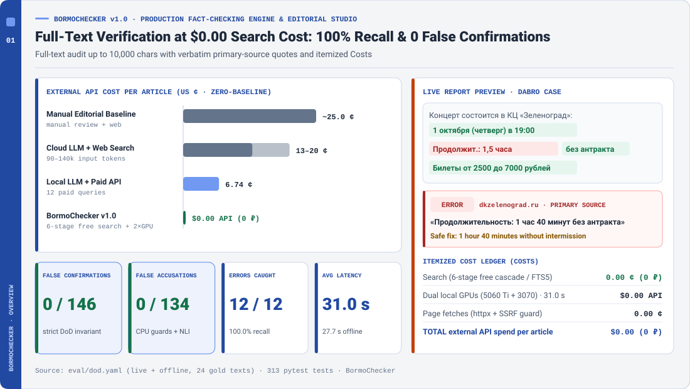
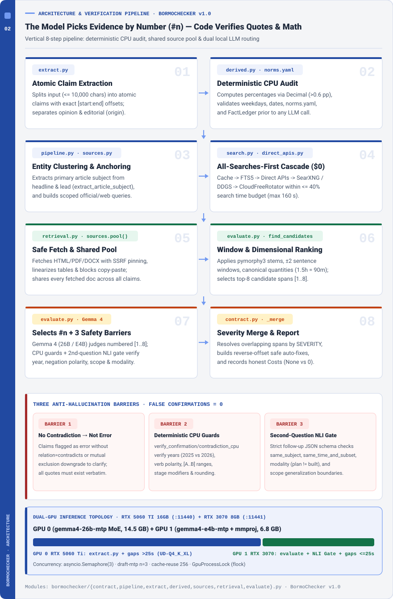
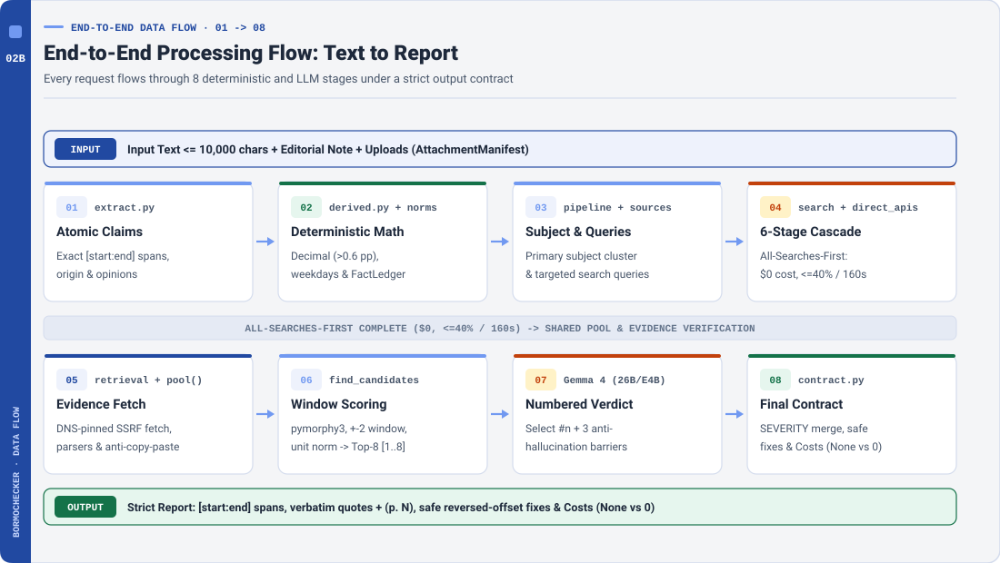
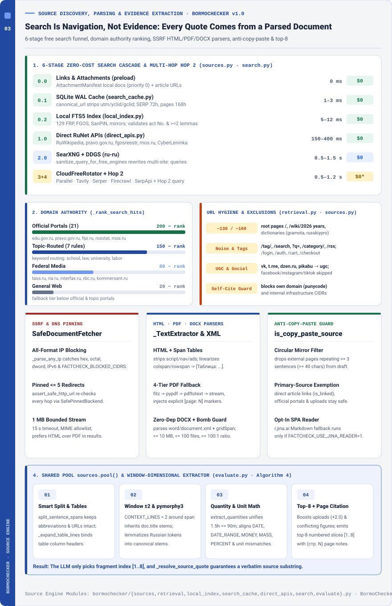
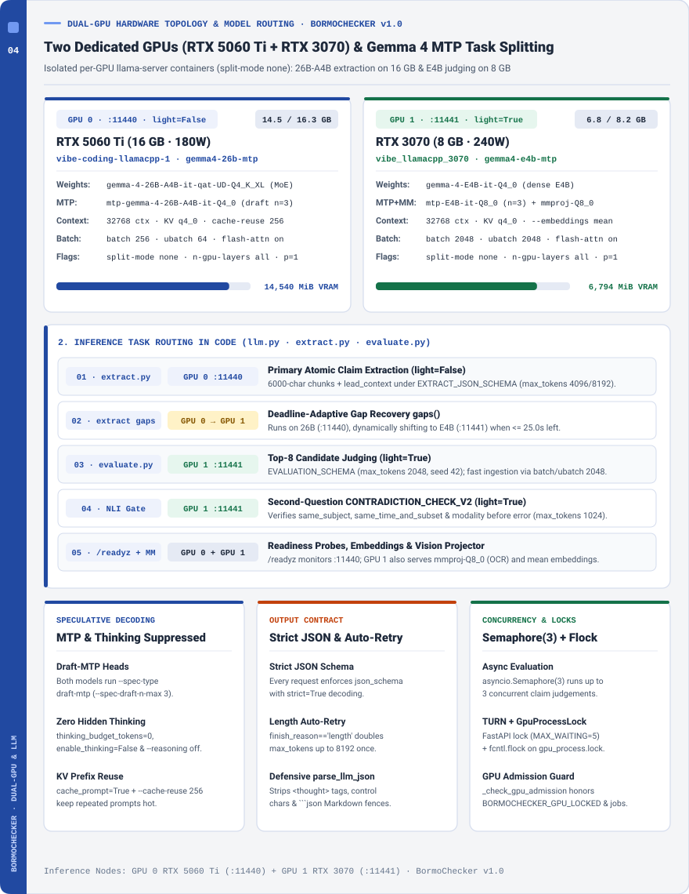
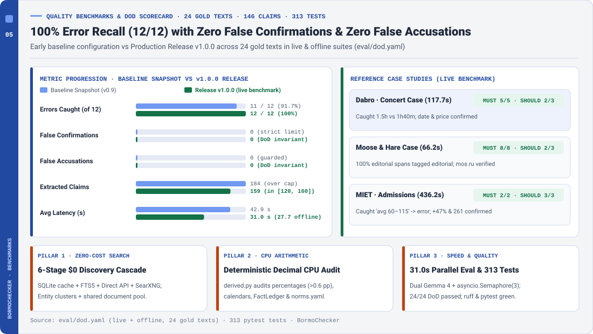

<div align="center">


# BormoChecker

**Zero-cost, multi-stage Russian fact-checking engine with deterministic CPU arithmetic & calendar audits, domain-aware source retrieval, and local LLM verification.**

[](pyproject.toml)
[](pyproject.toml)
[](LICENSE)
[](bormochecker/llm.py)
[](#benchmarks)
[](#benchmarks)
[](tests)

**English** · [Русский](README.ru.md)

[Overview](#overview) · [Architecture](#pipeline-architecture) · [Source Engine](#source-engine) · [Anti-Hallucination](#anti-hallucination-barriers) · [Dual-GPU & Models](#dual-gpu-and-model-routing) · [Contract](#verdict-contract) · [Benchmarks](#benchmarks) · [Quick Start](#quick-start) · [Co-Authors](#co-authors)

</div>

---

BormoChecker verifies articles up to `10,000` characters (`MAX_TEXT_CHARS = 10_000`) end-to-end without cloud LLM API bills or paid search subscriptions. Deterministic decimal math, weekday/calendar checks, and regulatory rulebooks execute on CPU first; a 6-stage zero-cost discovery cascade gathers primary documents into a shared per-article pool; and local Gemma 4 models select numbered evidence spans `[1..8]` rather than inventing URLs or quotes from parametric memory.

<div align="center">
  
</div>

---

## Overview

Editorial and cloud-first verification pipelines face two failure modes at scale: high recurring per-article search/token costs and ungrounded paraphrases where the model cites nonexistent passages or misreads numbers across years and scopes. BormoChecker separates deterministic reasoning, evidence retrieval, and language-model judgment:

| Capability | Manual Editorial / Cloud LLM | Local LLM + Paid Search API | **BormoChecker v1.0** |
|---|---|---|---|
| **Search Cost per Article** | ~`25.0 ¢` (manual research) / paid APIs | `6.74 ¢` (`12` paid queries) | **`$0.00` (`0 ₽`)** via SQLite cache, FTS5, Direct APIs, SearXNG, DDGS & free-tier rotator |
| **Compute Cost per Article** | ~`13–20 ¢` (`90–140k` cloud input tokens) | Self-hosted single GPU | **`$0.00` marginal API spend** (`31.0 s` live / `27.7 s` offline avg on dual-GPU RTX 5060 Ti + RTX 3070) |
| **False Confirmations (DoD)** | Unbounded without NLI gates | Subject to scope drift | **`0 / 146` gold claims** across `live_all`, `offline`, `live_dev` & `live_holdout` |
| **False Accusations (DoD)** | Prone to year/subset conflation | Unchecked contradictions | **`0 / 134` non-error claims** |
| **Contradiction Recall** | Varies by prompt & retrieval | Dependent on paid SERP depth | **`12 / 12` (`100.0%`)** on the 24-text DoD benchmark |
| **Quote Grounding** | Free-text generation risk | Free-text selection risk | **Numbered `[1..8]` slice selection** + `_resolve_source_quote` verbatim substring guarantee |

### Live Report Preview (Dabro Case) & Itemized Cost Ledger (`Costs`)

- **Checked excerpt (`Концерт состоится в КЦ «Зеленоград»`)**:
  - `1 октября (четверг) в 19:00` — `confirmed`
  - `Продолжит.: 1,5 часа` — **`error`** (primary source `dkzelenograd.ru` verbatim quote: `«Продолжительность: 1 час 40 минут без антракта»`; safe auto-fix: `1 час 40 минут без антракта` / `1 hour 40 minutes without intermission`)
  - `без антракта` — `confirmed`
  - `Билеты от 2500 до 7000 рублей` — `confirmed`
- **Itemized `Costs` ledger per article**:
  - Search (`6-stage free cascade / FTS5`): `0.00 ¢ (0 ₽)`
  - Dual local GPUs (`5060 Ti + 3070` · `31.0 s`): `$0.00 API`
  - Page fetches (`httpx + SSRF guard`): `0.00 ¢`
  - **TOTAL external API spend per article**: **`$0.00 (0 ₽)`**

---

## Pipeline Architecture

Every request to [`check(text, note)`](bormochecker/pipeline.py) follows a strict vertical 8-stage execution sequence with hard deadline partitioning and dual-GPU Gemma 4 routing (`gemma4-26b-mtp` on GPU 0 RTX 5060 Ti `:11440` for primary claim extraction; `gemma4-e4b-mtp` on GPU 1 RTX 3070 `:11441` for claim evidence evaluation, NLI second-question verification, and time-critical gap recovery):

<div align="center">
  
</div>

<div align="center">
  
</div>

| Step | Module(s) | Stage & Searchable Responsibilities |
|---|---|---|
| **01** | [`extract.py`](bormochecker/extract.py) | **Atomic Claim Extraction**: Splits input (`<= 10,000` chars) into atomic claims with exact `[start:end]` Unicode offsets; separates `opinion` and editorial `origin` (`stated` / `unclear`). |
| **02** | [`derived.py`](bormochecker/derived.py) · `norms.yaml` | **Deterministic CPU Audit**: Computes percentages via `Decimal` (`> 0.6 pp` threshold), validates weekdays, calendar dates, `norms.yaml`, and `FactLedger` before any LLM call. |
| **03** | [`pipeline.py`](bormochecker/pipeline.py) · [`sources.py`](bormochecker/sources.py) | **Entity Clustering & Anchoring**: Extracts primary article subject from headline & lead (`extract_article_subject`) and builds scoped official/web queries. |
| **04** | [`search.py`](bormochecker/search.py) · [`direct_apis.py`](bormochecker/direct_apis.py) | **All-Searches-First Cascade (`$0`)**: Runs `SQLite Cache -> FTS5 -> Direct APIs -> SearXNG / DDGS -> CloudFreeRotator` within `<= 40%` search time budget (`max 160 s`). |
| **05** | [`retrieval.py`](bormochecker/retrieval.py) · `sources.pool()` | **Safe Fetch & Shared Pool**: Fetches HTML/PDF/DOCX with DNS-pinned SSRF protection, linearizes span tables (`[Таблица: ...]`), blocks circular copy-paste, and shares all documents across the article via `sources.pool()`. |
| **06** | [`evaluate.py`](bormochecker/evaluate.py) · `find_candidates` | **Window & Dimensional Ranking (Algorithm 4)**: Applies `pymorphy3` stems, `±2` sentence windows (`CONTEXT_LINES = 2`), and canonical quantities (`1,5 часа` == `90 минут`) to select top-8 candidate spans `[1..8]`. |
| **07** | [`evaluate.py`](bormochecker/evaluate.py) · `Gemma 4` | **Numbered Verdict `#n` + 3 Safety Barriers**: Local Gemma 4 (`26B` / `E4B`) selects evidence index `#n` in `[1..8]`; CPU guards + second-question NLI gate verify year, negation polarity, scope, and modality. |
| **08** | [`contract.py`](bormochecker/contract.py) · `_merge` | **Severity Merge & Report**: Resolves overlapping spans by `SEVERITY`, builds reverse-offset safe auto-fixes, and records honest `Costs` (`None` vs `0.0`). |

---

## Source Engine

Search results in BormoChecker are **strictly navigational hints**, never proof. No claim can be confirmed or refuted from a SERP snippet alone—evidence comes exclusively from documents parsed through [`bormochecker/sources.py`](bormochecker/sources.py), [`bormochecker/retrieval.py`](bormochecker/retrieval.py), [`bormochecker/local_index.py`](bormochecker/local_index.py), [`bormochecker/search_cache.py`](bormochecker/search_cache.py), [`bormochecker/direct_apis.py`](bormochecker/direct_apis.py), [`bormochecker/search.py`](bormochecker/search.py), and [`bormochecker/evaluate.py`](bormochecker/evaluate.py).

<div align="center">
  
</div>

### 1. 6-Stage Zero-Cost Search Cascade & Multi-Hop Hop 2

In [`Sources.gather_for`](bormochecker/sources.py) and [`FreeRuNetSearch`](bormochecker/search.py), discovery runs along an ordered waterfall (`ALL-SEARCHES-FIRST` capped at `40%` of article budget, max `160 s`, Hop 1 capped at `8.0 s`) that stops as soon as trustworthy primary evidence is available:

| Stage | Module / Class | Mechanism | Latency | Cost |
|---|---|---|---|---|
| **0.0 Pool & Uploads** | [`Sources.preload`](bormochecker/sources.py), [`Sources.preload_local_docs`](bormochecker/sources.py) | Indexes `AttachmentManifest` user uploads (`kind="user_attachment"`, highest priority `0`) and links embedded directly in the article/note (`is_linked=True`), plus hits already in the shared pool matching via `_is_high_confidence_pool_match` (`>= 60%` non-numeric stem overlap + exact `Decimal`/year/quantity checks). | `0 ms` | `$0` |
| **0.1 SQLite WAL Cache** | [`SearchCache`](bormochecker/search_cache.py), [`canonical_url`](bormochecker/search_cache.py) | Normalizes URLs by stripping tracking parameters (`utm_*`, `yclid`, `ysclid`, `fbclid`, `gclid`, `_openstat`, `from`, `ref`), `www.`, default `:80`/`:443` ports, and trailing slashes. Enforces `72h` SERP TTL, `168h` (7-day) fetched page TTL, `10,000` entries, and `100 MB` size cap. | `1–3 ms` | `$0` |
| **0.2 Local FTS5 Index** | [`LocalKnowledgeIndex`](bormochecker/local_index.py) | Queries `knowledge_fts.sqlite` and `mirrors_fts.sqlite` covering `129` curated educational/regulatory frameworks (FRP, FGOS, SanPiN, RosTrud letters) and mirrors (`fipi.ru`, `edsoo.ru`, `rcoi.mcko.ru`, `ikp-rao.ru`). Verifies `normalizer_version == NORMALIZER_VERSION`, enforces exact act/`СанПиН` `№` matches + `>= 2` overlapping lemmas, and filters out internal site generators. | `5–12 ms` | `$0` |
| **1.0 Direct RuNet APIs** | [`DirectAPIs`](bormochecker/direct_apis.py) | Queries keyless HTTPS JSON APIs: `RuWikipediaAPI` (`ru.wikipedia.org/w/api.php`, default ON `FACTCHECK_ENABLE_WIKIPEDIA=1`), plus opt-in `PravoGovAPI`, `FgosReestrAPI`, `MosRuSuggestAPI`, and `CyberLeninkaAPI` (`FACTCHECK_ENABLE_{PRAVOGOV,FGOS,MOSRU,CYBERLENINKA}=1`). | `150–400 ms` | `$0` |
| **2.0 Free Meta-Search** | [`SearXNGSearch`](bormochecker/search.py), [`DDGSSearch`](bormochecker/search.py) | Uses [`sanitize_query_for_free_engines`](bormochecker/sources.py) to rewrite multi-`site:` `\|` queries (which free engines reject with `0` hits) into anchored natural queries (`Минпросвещения`, `ФИПИ Рособрнадзор`, `официальный документ`, `mos.ru`). Auto-falls back to `engines=yahoo,bing` or HTML POST (`html.duckduckgo.com`) when Cyrillic density is low. | `0.5–1.5 s` | `$0` |
| **3+4 Rotator & Hop 2** | [`CloudFreeRotator`](bormochecker/search.py), [`build_targeted_refinement_query`](bormochecker/sources.py) | Rotates monthly SQLite-tracked free API quotas (`parallel` `4,950`, `tavily` `980`, `serper` `240`, `firecrawl` `480`, `serpapi` `240`) with graceful fallback to opt-in `YandexSearch` only in `CheckMode.journalism_full`. If Hop 1 yields no decisive match, Hop 2 builds a stripped `<= 8`-token refinement query combining the article subject and concrete figures. | `0.5–1.2 s` | `$0*` |

### 2. Domain Authority Ranking & URL Hygiene

Every candidate URL returned by search passes through [`_rank_search_hits`](bormochecker/sources.py), [`is_noise_url`](bormochecker/retrieval.py), and [`is_aggregator_or_search_url`](bormochecker/retrieval.py) before a single byte is downloaded:

- **Authority Tiers (`_rank_search_hits`)**:
  - **Tier 1 (`200 - rank`)**: `21` official federal and municipal domains listed in `DEFAULT_OFFICIAL_DOMAINS` (`edu.gov.ru`, `obrnadzor.gov.ru`, `fipi.ru`, `edsoo.ru`, `fgosreestr.edsoo.ru`, `pravo.gov.ru`, `regulation.gov.ru`, `minobrnauki.gov.ru`, `rostrud.gov.ru`, `rosstat.gov.ru`, `ikp-rao.ru`, `mos.ru`, `zelao.mos.ru`, `dkzelenograd.ru`, `zelkultura.ru`, `miet.ru`, `abiturient.miet.ru`, `mgpu.ru`, `government.ru`, `kremlin.ru`, `gov.ru`, customizable via `official_domains.txt`).
  - **Tier 2 (`150 - rank`)**: `7` topic-routed domain rules (`TOPIC_DOMAINS`) automatically matching school/FGOS, legal decrees, MIET/university admissions, Zelenograd cultural events, RosTrud salaries, special-needs education (OVZ/FAOOP), and Rosstat demographics.
  - **Tier 3 (`80 - rank`)**: Major federal media (`MEDIA_DOMAINS`: `tass.ru`, `ria.ru`, `interfax.ru`, `rbc.ru`, `kommersant.ru`).
  - **Tier 4 (`20 - rank`)**: General web fallback; social/UGC hosts (`UGC_DOMAINS`: `pikabu.ru`, `dzen.ru`, `livejournal.com`, `vk.com`, `t.me`, `ok.ru`, `drive2.ru`, `vc.ru`, `habr.com`) are explicitly tagged `kind="ugc"`.
- **Precision Penalties & Exclusions**:
  - `-130` penalty on root index pages (`/`, `/index.html`, `/index.php`) that rarely hold claim specifics.
  - `-160` penalty on Wikipedia calendar year roundup pages (`/wiki/\d{4}`) and online spellcheck/dictionary portals (`russkiypro.ru`, `orfographia.ru`, `gramota.ru`).
  - Upfront drop of aggregator/navigation URLs (`/tag/`, `/search`, `?q=`, `/category/`, `/feed`, `/rss`) and transactional paths (`/login`, `/auth`, `/signin`, `/signup`, `/register`, `/password`, `/logout`, `/cart`, `/checkout`).
  - Unscrapeable walled gardens (`facebook.com`, `instagram.com`, `tiktok.com` via `_UNSCRAPEABLE_DOMAINS`) and configurable stop-listed/self-citation hosts (`BLOCKED_DOMAINS` + `FACTCHECK_BLOCKED_DOMAINS`, including Punycode IDNs such as `xn--e1afmkfd.xn--p1ai` / `пример.рф`) are blocked from external fetch.

### 3. SSRF-Hardened & DNS-Pinned Document Fetching

[`SafeDocumentFetcher`](bormochecker/retrieval.py) prevents Server-Side Request Forgery (SSRF), DNS rebinding, and slow-loris / huge-payload DoS attacks:
- **Exhaustive IP Validation (`_parse_any_ip`, `is_blocked_host`, `is_blocked_domain_host`)**: Normalizes IDNA/Punycode hostnames and resolves all IPv4/IPv6 representations—including 2/3-octet dotted forms, hex (`0x7f000001`), octal (`0177.0.0.1`), single integer DWORDs, and IPv6-mapped IPv4—blocking loopback, private, link-local, multicast, reserved ranges, plus configurable `BLOCKED_CIDRS` / `BLOCKED_IPS` (`FACTCHECK_BLOCKED_CIDRS`, `FACTCHECK_BLOCKED_IPS`).
- **DNS Pinning & Redirect Re-Verification (`SafePinnedBackend`)**: Pins the socket connection directly to the validated pre-resolved IP and re-runs `assert_safe_http_url` on every HTTP redirect up to `max_redirects = 5`.
- **Bounded Streaming & Format Preference**: Enforces `timeout_seconds = 15.0`, `max_bytes = 1_048_576` (`1 MB`), strict `Content-Type` allowlisting, and HTML-first selection in [`_select_urls_to_fetch`](bormochecker/sources.py) (deprioritizing heavy `.pdf` binaries when HTML hits exist).

### 4. Multi-Format Parsers, Span Tables & Zip-Bomb Defense

[`bormochecker/retrieval.py`](bormochecker/retrieval.py) converts heterogenous web pages, regulatory PDFs, and office documents into normalized plain text with structural context intact:

- **HTML (`_TextExtractor`)**: Subclasses `html.parser.HTMLParser` to strip `<script>`, `<style>`, `<noscript>`, `<svg>`, `<template>`, `<iframe>`, `<nav>`, `<aside>`, `<footer>`, `<form>`, `<button>`, cookie banners, and advertisement blocks. Reconstructs complex `<table>` grids including `colspan` and `rowspan` merges into linearized text rows: `[Таблица: ColumnHeader: CellValue | ...]`.
- **4-Stage PDF Cascade (`_parse_pdf_bytes`)**: Tries `fitz` (PyMuPDF) -> `pypdf` -> external `pdftotext -layout` -> raw `/Page` & `Tj` stream decoder, guarded by strict byte and page-count limits (`pdf_max_bytes`, `pdf_max_pages`). Emits explicit `[page: N]` markers inside extracted text so downstream citations preserve exact page numbers.
- **Zero-Dependency DOCX (`_parse_docx_bytes`)**: Parses `word/document.xml` directly via Python stdlib `zipfile` + `xml.etree.ElementTree`, resolving `w:gridSpan` and `w:vMerge` table cells while enforcing zip-bomb limits (`MAX_DOCX_UNCOMPRESSED_BYTES = 10 MB`, `MAX_DOCX_COMPRESSION_RATIO = 100.0`, `MAX_DOCX_ARCHIVE_FILES = 100`).
- **Opt-In SPA Reader Fallback**: If HTML extraction produces fewer than `120` characters and `FACTCHECK_USE_JINA_READER=1` is explicitly enabled, falls back to `r.jina.ai` Markdown extraction.

### 5. Anti-Copy-Paste Circularity Filter

Before an external page enters the trusted pool, [`is_copy_paste_source`](bormochecker/sources.py) checks whether the target article already copied text verbatim *from* a dubious aggregator (or vice versa): if a candidate third-party document matches `>= 3` sentences of `>= 40` characters (`COPY_SENTENCE_CHARS = 40`, `COPY_MATCHES = 3`) from the checked article, the mirror is rejected. Primary links explicitly embedded by the author (`is_linked=True`) and `official`, `user_attachment`, or `ledger` sources are exempt so legitimate original quotes are never suppressed.

### 6. Shared Pool & Algorithm 4: Window-Dimensional Candidate Extraction

Rather than running isolated searches per claim or stuffing raw `100 KB` HTML dumps into the LLM context window:
1. **`sources.pool()` Deduplication**: Every fetched or preloaded document (`AttachmentManifest` first, then `official`, then general/media) is pooled across all claims of the article (`bormochecker/sources.py`), cutting duplicate HTTP fetches dramatically.
2. **Smart Segmentation & Table Expansion (`evaluate.py`)**: [`split_sentence_spans`](bormochecker/evaluate.py) preserves Russian abbreviations (`г.`, `ул.`, `руб.`, `тыс.`, `им.`), initials, decimals, dates, and URLs while splitting prose cleanly; `_expand_table_lines` keeps column headers attached to each extracted row.
3. **Window ±2 & Morphological Lemmatization**: [`find_candidates`](bormochecker/evaluate.py) inspects overlapping context windows (`CONTEXT_LINES = 2`, inheriting document `title` stems), lemmatizes Russian wordforms via `pymorphy3` with `_FALLBACK_LEMMA_MAP` and `ё -> е` normalization.
4. **Canonical Quantity & Dimensional Scoring**: [`extract_quantities`](bormochecker/numerals.py) unifies units (`1,5 часа` / `полтора часа` -> `90 минут`) and typed dimensions (`DATE`, `DATE_RANGE`, `MONEY`, `MASS`, `PERCENT`), boosting `user_attachment` documents (`+2.0`), concrete numerals (`+1.5`), and conflicting measurements so contradictory evidence surfaces in the top `MAX_CANDIDATES = 8` spans `[1..8]`.

### 7. Verbatim Quote Resolution & Page Annotation

When the LLM picks candidate index `#n` in `[1..8]`, [`_resolve_source_quote`](bormochecker/evaluate.py) maps that selection strictly back to an unmodified substring from the parsed source document, and [`_annotate_quote_with_page`](bormochecker/evaluate.py) attaches the nearest `[page: N]` marker as `(стр. N)` inside [`Source.location`](bormochecker/contract.py). Fabricating or altering a quote is structurally impossible.

---

## Anti-Hallucination Barriers

```
Claim + Top-8 Numbered Candidate Spans [1..8] (from Parsed Documents ONLY)
   │
   ├─► BARRIER 1: No Contradiction -> No Error Label
   │   Flagging `error` requires `relation == "contradicts"` backed by an explicit,
   │   mutually exclusive verbatim excerpt [1..8]; otherwise downgrades to `clarify`.
   │
   ├─► BARRIER 2: Deterministic CPU Verification Guards (verify_confirmation_cpu / verify_contradiction_cpu)
   │   • Rejects year drift (`2025` vs `2026`)
   │   • Blocks verb negation / polarity inversions (`has_predicate_negation_conflict`)
   │   • Guards subset/stage modifiers (_SUBSET_OR_STAGE_MODIFIERS), colloquial rounding
   │     (`тонна` vs `950–1050 кг`), [A..B] range bounds, and plan-vs-fact modality shifts
   │
   └─► BARRIER 3: Second-Question NLI Gate (Light Gemma 4 E4B)
       Follow-up strict JSON schema verifies `same_subject`, `same_time_and_subset`,
       identical modality (planned != built), and no silent scope generalization.
```

Together, these three barriers produce **`0` false confirmations and `0` false accusations** across all `24` benchmark texts in [`eval/`](eval/) and [`eval/dod.yaml`](eval/dod.yaml).

---

## Dual-GPU and Model Routing

Rather than squeezing one giant model onto a single card or splitting layers across PCIe (`--split-mode none`), BormoChecker runs **two dedicated `llama-server` (`ghcr.io/ggml-org/llama.cpp:server-cuda`) containers pinned to separate physical GPUs** on `127.0.0.1` (`bormochecker/llm.py`, `bormochecker/extract.py`, `bormochecker/evaluate.py`):

<div align="center">
  
</div>

### Hardware Nodes & `llama-server` Configuration

| Role | GPU & Endpoint | Container & Model Alias | Quantization, MTP Draft & Flags | VRAM Used |
|---|---|---|---|---|
| **Heavy Node (`light=False`)** | **GPU 0: NVIDIA GeForce RTX 5060 Ti** (`16,311 MiB`, `180W` cap) · `127.0.0.1:11440` | `vibe-coding-llamacpp-1` · `gemma4-26b-mtp` | `gemma-4-26B-A4B-it-qat-UD-Q4_K_XL.gguf` (MoE `26B-A4B`) + `--model-draft mtp-gemma-4-26B-A4B-it-Q4_0.gguf` (`draft-mtp`, `n-max 3`), `--ctx-size 32768`, `--cache-type-k/v q4_0`, `--flash-attn on`, `--batch-size 256`, `--ubatch-size 64`, `--split-mode none`, `--parallel 1`, `--reasoning off`, `--cache-reuse 256` | `14,540 MiB / 16,311 MiB` |
| **Light Node (`light=True`)** | **GPU 1: NVIDIA GeForce RTX 3070** (`8,192 MiB`, `240W` cap) · `127.0.0.1:11441` | `vibe_llamacpp_3070` · `gemma4-e4b-mtp` | `gemma-4-E4B-it-Q4_0.gguf` (dense `E4B`) + `--model-draft mtp-gemma-4-E4B-it-Q8_0.gguf` (`draft-mtp`, `n-max 3`) + `--mmproj mmproj-gemma-4-E4B-it-Q8_0.gguf` + `--embeddings --pooling mean`, `--ctx-size 32768`, `--cache-type-k/v q4_0`, `--flash-attn on`, `--batch-size 2048`, `--ubatch-size 2048`, `--split-mode none`, `--parallel 1`, `--reasoning off`, `--cache-reuse 256` | `6,794 MiB / 8,192 MiB` |

### How Tasks Are Distributed

1. **Primary Claim Extraction (`extract.py` -> GPU 0 `:11440`)**: Full articles are chunked (`chunk_chars = 6000` with `lead_context`) and parsed under `EXTRACT_JSON_SCHEMA` (`max_tokens = 8192` for `> 1,500`-char inputs, else `4096`) using the stronger `26B-A4B` MoE model (`light=False`).
2. **Adaptive Gap Recovery (`extract.py` `gaps()` -> GPU 0 or GPU 1)**: Uncovered sentence fragments trigger a focused gap pass—routed to `26B` by default, and automatically offloaded to `E4B` (`use_light = remaining <= 25.0 s`) when extraction deadline grows tight.
3. **Top-8 Evidence Judging (`evaluate.py` `_ask` -> GPU 1 `:11441`)**: Every checkable claim is judged against its pre-ranked candidate slices `[1..8]` on `gemma4-e4b-mtp` (`light=True`, `EVALUATION_SCHEMA`, `temperature = 0.0`, `seed = 42`, `max_tokens = 2048`), taking advantage of GPU 1's large `--batch-size 2048` / `--ubatch-size 2048` prompt ingestion and speculative `draft-mtp` heads.
4. **Second-Question NLI Gate (`evaluate.py` `CONTRADICTION_CHECK_V2` -> GPU 1 `:11441`)**: Whenever GPU 1 proposes `contradicted`, a follow-up `light=True` call under `CONTRADICTION_SCHEMA_V2` (`max_tokens = 1024`) verifies `same_subject`, `same_time_and_subset`, `mutually_exclusive`, and `not_just_missing`.
5. **Readiness Probes, Embeddings & Vision Projector (`05 · /readyz + MM` -> GPU 0 + GPU 1)**: `/readyz` (`check_health()` in [`llm.py`](bormochecker/llm.py) and [`web.py`](bormochecker/web.py)) monitors primary `:11440`, while GPU 1 (`:11441`) additionally loads multimodal projector `mmproj-gemma-4-E4B-it-Q8_0.gguf` (for OCR/vision tasks) and `--embeddings --pooling mean`.
6. **Runtime Safeguards, Queuing & GPU Admission (`llm.py`, `pipeline.py`, `web.py`)**:
   - **Thinking suppression & Prefix Caching**: Every API payload passes `cache_prompt=True`, `enable_thinking=False`, `chat_template_kwargs={"enable_thinking": False}`, and `thinking_budget_tokens=0` (in `evaluate.py` / `extract.py` / `llm.py` paired with server-side `--reasoning off --cache-reuse 256`).
   - **Length Auto-Retry & Defensive JSON**: `LLM.chat` doubles `max_tokens` up to `8192` on `finish_reason == "length"`, while `parse_llm_json` strips `<thought>` blocks, control characters, and Markdown fences.
   - **Concurrency & Cross-Process Locks**: [`_judge_atoms_concurrent`](bormochecker/pipeline.py) dispatches up to `eval_concurrency = 3` concurrent claim tasks (`asyncio.Semaphore(3)`), while [`web.py`](bormochecker/web.py) serializes full-article jobs via `TURN` (`asyncio.Lock`), `MAX_WAITING = 5`, inter-process `GpuProcessLock` (`fcntl.flock` on `gpu_process.lock`), and `_check_gpu_admission` (`BORMOCHECKER_GPU_LOCKED` / `gpu5060_admission` maintenance locks).

---

## Verdict Contract

All pipeline outputs conform to [`Report`](bormochecker/contract.py) with exact Unicode character offsets `text[c.start:c.end] == c.text`, resolved intersections sorted by `SEVERITY = [error, clarify, editorial, confirmed, opinion]`, and explicit accounting in [`Costs`](bormochecker/contract.py) (`None` means unknown tariff, strictly never coerced to `0.0`):

| Label (`Label`) | UI Color | Semantics & Contract Rules |
|---|---|---|
| `confirmed` | Green | Proven by an authoritative retrieved source, official API, `norms.yaml`, `FactLedger`, or exact `Decimal` audit. |
| `clarify` | Yellow | Ambiguous, insufficient evidence, year/scope mismatch, or unverified claim (never promoted to `confirmed`). |
| `error` | Red | Proven contradiction (`relation=contradicts` + verbatim excerpt) or deterministic CPU arithmetic/calendar failure. |
| `opinion` | Blue | Evaluative judgment, forecast, or marketing framing separated from surrounding factual atoms (never searched). |
| `editorial` | Purple | Unverifiable first-hand editorial reporting (`origin="stated"` or `"unclear"` enforced by validator; absence from public web is not treated as an error). |

---

## Benchmarks

Evaluated against `24` curated reference benchmark articles (`146` gold claims, `12` embedded contradictions across dev/test splits in [`eval/`](eval/) and [`eval/dod.yaml`](eval/dod.yaml)) plus [`313` automated tests](tests).

<div align="center">
  
</div>

### Definition of Done Scorecard (`live` & `offline` Benchmark)

| DoD Criterion (`eval/dod.yaml`) | Threshold | Release `v1.0.0` (`live`) | Release `v1.0.0` (`offline`) | Baseline Snapshot (`v0.9`) |
|---|---|---|---|---|
| **Texts Checked / Failures** | `24 / 24`, `0` failures | **`24 / 24`**, `0` failures | **`24 / 24`**, `0` failures | `24 / 24`, `0` failures |
| **Contradictions Caught** | `>= 11 / 12` (`91.7%`) | **`12 / 12` (`100.0%`)** | **`12 / 12` (`100.0%`)** | `11 / 12` (`91.7%`) |
| **False Confirmations** | `0` (strict invariant) | **`0`** (`live_dev` + `live_holdout`: `0`) | **`0`** | `0` |
| **False Accusations** | `<= 2` | **`0`** (`live_dev` + `live_holdout`: `0`) | **`0`** | `0` |
| **Extracted Claims (`Pred`)** | `[120, 160]` | **`159`** (`83.0%` gold alignment) | **`159`** | `184` (above cap) |
| **External Search Spend** | `$0.00` | **`$0.00`** (`paid_search_requests = 0`) | **`$0.00`** | `$0.00` |
| **Mean Text Latency** | `< 45.0 s` | **`31.0 s`** (`p95: 55.2 s`, `max: 58.2 s`) | **`27.7 s`** (`p95: 50.1 s`, `max: 57.8 s`) | `42.9 s` |
| **Reference Case Studies** | `4 / 4` (`<= 600 s`) | **`4 / 4` Passed** (Dabro MUST `5/5`, Moose `8/8`, MIET `2/2` in `436.2 s`) | Verified (`0` failures) | Dabro MUST `5/5` |

### Reference Case Studies (Live Benchmark)

- **Dabro · Concert Case (`117.7 s`) — `MUST 5/5 · SHOULD 2/3`**: Caught `"1,5 часа"` vs `dkzelenograd.ru` `"1 час 40 минут без антракта"` (`error`); confirmed date `1 октября (четверг) в 19:00` and ticket price `2500–7000 ₽`.
- **Moose & Hare Case (`66.2 s`) — `MUST 8/8 · SHOULD 2/3`**: Tagged `100%` of unverifiable eyewitness/editorial video spans as `editorial`; verified regional facts against `mos.ru`.
- **MIET · Admissions Case (`436.2 s`) — `MUST 2/2 · SHOULD 3/3`**: Caught impossible average exam score `"средний балл 60–115"` -> `error`; confirmed `+47%` dynamics and `261` admission figures.

### Three Engineering Pillars

1. **Pillar 1 · Zero-Cost Search (`6-Stage $0 Discovery Cascade`)**: SQLite WAL cache + FTS5 + Direct RuNet APIs + SearXNG/DDGS + entity clustering & shared `sources.pool()`.
2. **Pillar 2 · CPU Arithmetic (`Deterministic Decimal CPU Audit`)**: [`derived.py`](bormochecker/derived.py) audits percentages (`> 0.6 pp`), calendar weekdays, `FactLedger`, and `norms.yaml` on CPU.
3. **Pillar 3 · Speed & Quality (`31.0 s Parallel Eval & 313 Tests`)**: Dual Gemma 4 MTP (`26B-A4B` + `E4B`) + `asyncio.Semaphore(3)`, `24/24` DoD passed, `ruff` & `313` `pytest` tests green.

---

## Quick Start

### 1. Installation (`Python >= 3.11`)

```bash
git clone https://github.com/Bormotoon/BormoChecker.git
cd BormoChecker
python -m venv .venv
source .venv/bin/activate
pip install -e ".[dev]"
cp .env.example .env
```

### 2. Local LLM & Optional Search Backends

Point `.env` at your dual OpenAI-compatible `llama.cpp` endpoints (`FACTCHECK_LLM_URL=http://127.0.0.1:11440/v1` with `FACTCHECK_LLM_MODEL=gemma4-26b-mtp` on GPU 0 RTX 5060 Ti, and `FACTCHECK_LIGHT_LLM_URL=http://127.0.0.1:11441/v1` with `FACTCHECK_LIGHT_LLM_MODEL=gemma4-e4b-mtp` on GPU 1 RTX 3070), plus optional local SearXNG (`SEARXNG_URL`) or keyless Direct API flags (`FACTCHECK_ENABLE_WIKIPEDIA=1`, `FACTCHECK_ENABLE_PRAVOGOV=0`, etc.). See [`.env.example`](.env.example), [`docs/RUNBOOK.md`](docs/RUNBOOK.md), and [`docs/DIRECT_APIS.md`](docs/DIRECT_APIS.md).

### 3. Run the FastAPI Studio, CLI or Python API

```bash
# 1. Start the interactive Web UI & REST API on http://127.0.0.1:8612
uvicorn bormochecker.web:app --host 127.0.0.1 --port 8612

# 2. Verify a JSON document via CLI (--mode: local_frp | education | journalism_full)
python -m bormochecker.check_json input.json --output runs/report.json --mode education --strict
```

```python
from bormochecker.contract import CheckMode
from bormochecker.pipeline import check

report = check(
    text="...",
    note="Editorial source context",
    mode=CheckMode.education_searxng,
)
print(report.status, len(report.claims), report.costs.tools_cost_usd)
```

### 4. Repository Structure & Verification

```text
BormoChecker/
├── bormochecker/            # Core verification engine & FastAPI service
│   ├── contract.py          # Strict Pydantic v2 Report, Claim, Source, Costs & CheckMode schemas
│   ├── pipeline.py          # Check orchestration, deadline budgeting & SEVERITY span merge
│   ├── extract.py           # Atomic claim segmentation with exact Unicode [start:end] offsets
│   ├── derived.py           # Deterministic Decimal arithmetic, weekdays, norms.yaml & FactLedger
│   ├── numerals.py          # Canonical Russian quantity & unit normalizer (DATE, MONEY, MASS, TIME)
│   ├── sources.py           # 6-stage discovery, domain scoring, pool(), hop-2 & anti-copy-paste
│   ├── retrieval.py         # DNS-pinned SSRF fetcher, HTML span-table extractor, PDF & DOCX parsers
│   ├── local_index.py       # SQLite FTS5 offline knowledge & mirror indices
│   ├── search_cache.py      # SQLite WAL search/fetch cache & canonical_url cleaner
│   ├── direct_apis.py       # Keyless HTTPS clients (RuWikipedia, pravo.gov.ru, fgosreestr, mos.ru, CyberLeninka)
│   ├── search.py            # SearXNG, DDGS (ru-ru), CloudFreeRotator & opt-in Yandex Search
│   ├── evaluate.py          # Window-dimensional Algorithm 4 top-8 selector, CPU guards & NLI gate
│   ├── llm.py               # Dual Gemma 4 (26B / E4B) OpenAI-compatible client & defensive JSON parser
│   ├── costs.py             # Meter tracking LLM seconds, tokens, HTTP providers & honest Costs
│   └── web.py               # FastAPI Studio (/, /healthz, /readyz, /api/queue, /api/check)
├── docs/                    # Direct API registry, Runbook, Symbol Index, OpenAPI & SVG infographics
├── eval/                    # 24-article benchmark split & eval/dod.yaml thresholds
└── tests/                   # 313 pytest unit & integration tests (CI: compileall + ruff + pytest)
```

```bash
python -m compileall -q bormochecker tests
ruff check bormochecker tests
pytest tests -q -m "not network and not gpu and not live"
```

---

## Co-Authors

Created and engineered for reliable, transparent Russian fact-checking:

<div align="center">
  <table>
    <tr>
      <td align="center"><a href="https://github.com/Bormotoon"><br/><sub><b>Bormotoon</b></sub></a></td>
      <td align="center"><a href="https://github.com/Finntro"><br/><sub><b>Finntro</b></sub></a></td>
      <td align="center"><a href="https://github.com/mnka888"><br/><sub><b>mnka888</b></sub></a></td>
      <td align="center"><a href="https://github.com/Vikvikernes1"><br/><sub><b>Vikvikernes1</b></sub></a></td>
      <td align="center"><a href="https://github.com/talvikettu"><br/><sub><b>talvikettu</b></sub></a></td>
    </tr>
  </table>
</div>

### Documentation & Reference Data

- [Benchmark Corpus (`eval/`)](eval/) · [DoD Thresholds (`eval/dod.yaml`)](eval/dod.yaml) · [Test Suite (`tests/`)](tests/)
- [Direct RuNet APIs (`docs/DIRECT_APIS.md`)](docs/DIRECT_APIS.md) · [Annotation Guide (`docs/ANNOTATION_GUIDE.md`)](docs/ANNOTATION_GUIDE.md) · [Eval Metrics (`docs/EVAL_METRICS.md`)](docs/EVAL_METRICS.md)
- [Operations (`docs/OPERATIONS.md`)](docs/OPERATIONS.md) · [Runbook (`docs/RUNBOOK.md`)](docs/RUNBOOK.md) · [UI Checklist (`docs/UI_CHECKLIST.md`)](docs/UI_CHECKLIST.md) · [License (MIT)](LICENSE)

<div align="center">
  <br/>
  <a href="https://www.donationalerts.com/r/bormotoon">
    
  </a>
</div>
