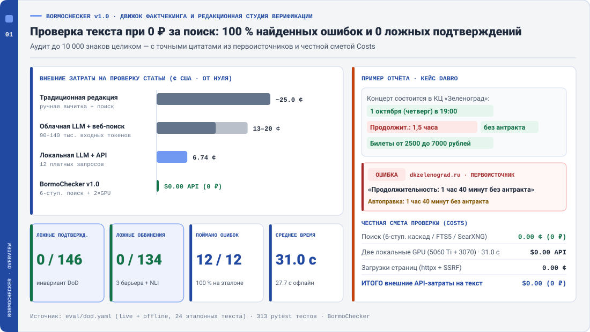
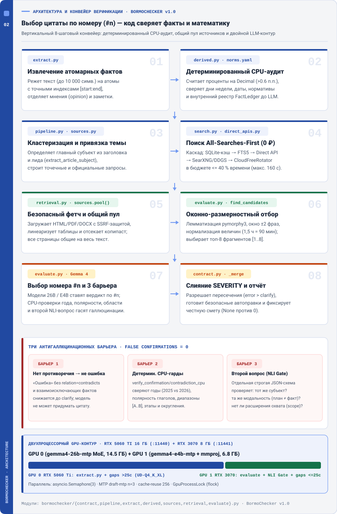
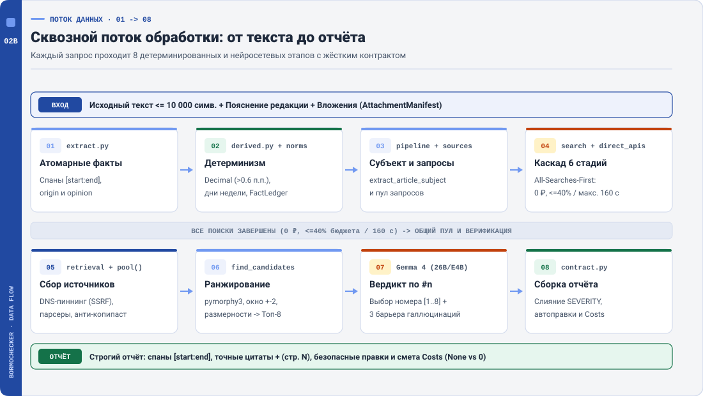
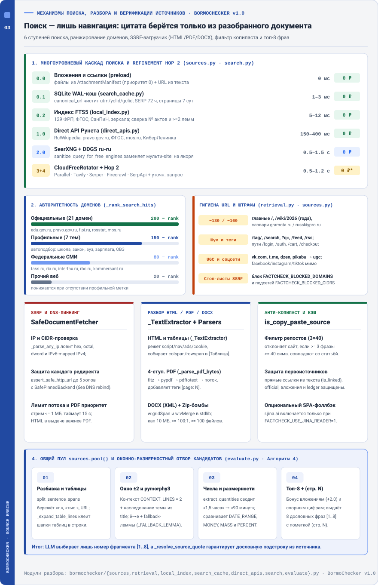
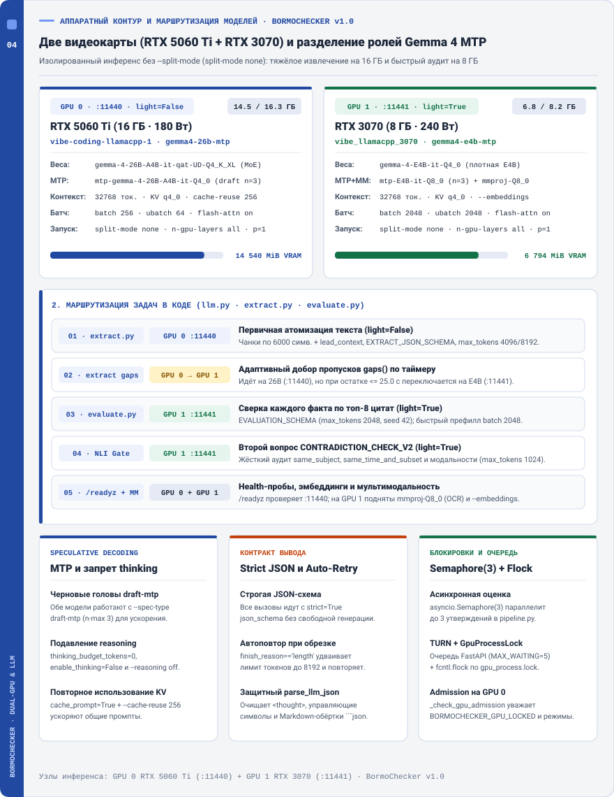
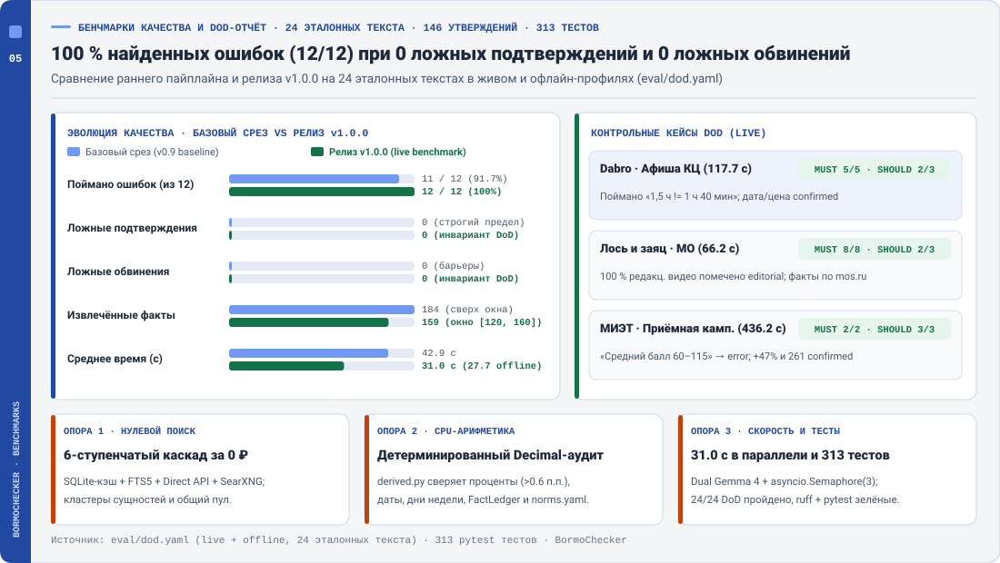

<div align="center">


# BormoChecker

**Движок фактчекинга с нулевыми затратами на поиск: детерминированный CPU-аудит арифметики и дат, умный разбор первоисточников и локальная верификация на базе Gemma 4.**

[](pyproject.toml)
[](pyproject.toml)
[](LICENSE)
[](bormochecker/llm.py)
[](#бенчмарки)
[](#бенчмарки)
[](tests)

[English](README.md) · **Русский**

[Обзор](#обзор) · [Архитектура](#архитектура-конвейера) · [Движок источников](#движок-источников) · [Антигаллюцинации](#барьеры-против-галлюцинаций) · [GPU и модели](#двухпроцессорный-gpu-контур-и-маршрутизация-моделей) · [Контракт](#контракт-вердиктов) · [Бенчмарки](#бенчмарки) · [Быстрый старт](#быстрый-старт) · [Соавторы](#соавторы)

</div>

---

BormoChecker проверяет статьи объёмом до `10 000` символов (`MAX_TEXT_CHARS = 10_000`) без счетов за облачные LLM и платные поисковые API. Детерминированная математика на `Decimal`, календарные проверки дней недели и нормативные справочники выполняются на CPU до первого вызова модели; 6-ступенчатый бесплатный каскад поиска собирает документы в общий пул статьи; а локальные модели Gemma 4 выбирают доказательство строго по номеру фрагмента `[1..8]`, не придумывая ни URL, ни цитаты.

<div align="center">
  
</div>

---

## Обзор

Редакционные и облачные системы фактчекинга обычно сталкиваются с двумя проблемами: высокой стоимостью регулярных прогонов по крупным статьям и галлюцинациями моделей, которые пересказывают чужие сниппеты или путают числа разных лет. BormoChecker физически разделяет детерминированную логику, добычу документов и вынесение вердикта:

| Показатель | Ручная редакция / Облачная LLM | Локальная LLM + платный API | **BormoChecker v1.0** |
|---|---|---|---|
| **Затраты на поиск** | ~`25.0 ¢` (ручная вычитка + поиск) | `6.74 ¢` (`12` платных запросов) | **`0.00 ₽ ($0.00)`** (SQLite-кэш, FTS5, Direct API, SearXNG, DDGS, ротатор квот) |
| **Затраты на вычисления** | ~`13–20 ¢` (`90–140 тыс.` входных токенов) | Локальная LLM на 1 GPU | **`$0.00`** за API-вызовы (`31.0 с` live / `27.7 с` офлайн в среднем на двух GPU: RTX 5060 Ti + RTX 3070, `gemma4-26b-mtp` + `gemma4-e4b-mtp`) |
| **Ложные подтверждения (DoD)** | Без строгих NLI-проверок не ограничены | Риск подмены контекста | **`0 / 146` эталонных фактов** во всех профилях (`live_all`, `offline`, `live_dev`, `live_holdout`) |
| **Ложные обвинения (DoD)** | Частая путаница лет и подвыборок | Непроверенные отрицания | **`0 / 134` нейтральных/верных фактов** |
| **Полнота выявления ошибок** | Зависит от глубины ручного/SERP-поиска | Зависит от платного поиска | **`12 / 12` (`100.0%`)** на 24 эталонных текстах DoD |
| **Гарантия подлинности цитаты** | Риск перефразирования моделью | Свободная генерация текста | **Выбор номера `[1..8]`** + дословная подстрока `_resolve_source_quote` |

### Пример разбора (Кейс Dabro) и честная смета проверки (`Costs`)

- **Проверяемый фрагмент (`Концерт состоится в КЦ «Зеленоград»`)**:
  - `1 октября (четверг) в 19:00` — `confirmed`
  - `Продолжит.: 1,5 часа` — **`error`** (первоисточник `dkzelenograd.ru`, дословная цитата: `«Продолжительность: 1 час 40 минут без антракта»`; безопасная автоправка: `1 час 40 минут без антракта`)
  - `без антракта` — `confirmed`
  - `Билеты от 2500 до 7000 рублей` — `confirmed`
- **Честная смета (`Costs`) на одну статью**:
  - Поиск (`6-ступ. каскад / FTS5 / SearXNG`): `0.00 ¢ (0 ₽)`
  - Две локальные GPU (`5060 Ti + 3070 · 31.0 с`): `$0.00 API`
  - Загрузки страниц (`httpx + SSRF`): `0.00 ¢`
  - **ИТОГО внешние API-затраты на текст**: **`$0.00 (0 ₽)`**

---

## Архитектура конвейера

Каждый вызов [`check(text, note)`](bormochecker/pipeline.py) выполняется по строгому вертикальному 8-шаговому конвейеру с жёстким распределением бюджета времени и маршрутизацией на две локальные модели Gemma 4 по разным GPU (`gemma4-26b-mtp` на GPU 0 RTX 5060 Ti `:11440` — первичное извлечение атомарных утверждений; `gemma4-e4b-mtp` на GPU 1 RTX 3070 `:11441` — параллельная верификация top-8 клаимов, NLI-аудит вторым вопросом и экстренное доизвлечение при малом остатке бюджета):

<div align="center">
  
</div>

<div align="center">
   08)" width="100%"/>
</div>

| Шаг | Модуль(и) | Этап и ключевые функции (для поиска и аудита) |
|---|---|---|
| **01** | [`extract.py`](bormochecker/extract.py) | **Извлечение атомарных фактов**: режет текст (до `10 000` симв.) на атомы с точными индексами `[start:end]`, отделяет мнения (`opinion`) и редакционные заявления (`origin`: `stated` / `unclear`). |
| **02** | [`derived.py`](bormochecker/derived.py) · `norms.yaml` | **Детерминированный CPU-аудит**: считает проценты на `Decimal` (порог `> 0.6 п.п.`), сверяет дни недели, календарные даты, нормативы `norms.yaml` и внутренний реестр `FactLedger` до первого вызова LLM. |
| **03** | [`pipeline.py`](bormochecker/pipeline.py) · [`sources.py`](bormochecker/sources.py) | **Кластеризация и привязка темы**: выделяет главный субъект из заголовка и лида (`extract_article_subject`) и формирует точечные и официальные поисковые запросы. |
| **04** | [`search.py`](bormochecker/search.py) · [`direct_apis.py`](bormochecker/direct_apis.py) | **Поиск All-Searches-First (`0 ₽`)**: каскад `SQLite-кэш -> FTS5 -> Direct API -> SearXNG / DDGS -> CloudFreeRotator` в бюджете `<= 40 %` времени (макс. `160 с`). |
| **05** | [`retrieval.py`](bormochecker/retrieval.py) · `sources.pool()` | **Безопасный фетч и общий пул**: загружает HTML/PDF/DOCX с DNS-пиннингом и SSRF-защитой, линеаризует таблицы (`[Таблица: ...]`), отсекает копипаст и шарит страницы на всю статью через `sources.pool()`. |
| **06** | [`evaluate.py`](bormochecker/evaluate.py) · `find_candidates` | **Оконно-размерностный отбор (Алгоритм 4)**: лемматизация `pymorphy3`, окно `±2` фраз (`CONTEXT_LINES = 2`), нормализация величин (`1,5 часа` == `90 минут`) -> отбор топ-8 фрагментов `[1..8]`. |
| **07** | [`evaluate.py`](bormochecker/evaluate.py) · `Gemma 4` | **Выбор номера `#n` и 3 барьера**: локальные Gemma 4 (`26B` / `E4B`) выбирают `#n` из `[1..8]`; CPU-гарды и второй NLI-вопрос проверяют год, полярность отрицания, охват (scope) и модальность. |
| **08** | [`contract.py`](bormochecker/contract.py) · `_merge` | **Слияние `SEVERITY` и отчёт**: разрешает пересечения интервалов (`error > clarify`), готовит безопасные автоправки с обратными сдвигами и фиксирует честную смету `Costs` (`None` против `0.0`). |

---

## Движок источников

Поисковая выдача в BormoChecker служит **лишь навигацией**, а не доказательством. Вердикт никогда не ставится по сниппету поисковика: любая цитата извлекается исключительно из загруженного и разобранного документа через модули [`bormochecker/sources.py`](bormochecker/sources.py), [`bormochecker/retrieval.py`](bormochecker/retrieval.py), [`bormochecker/local_index.py`](bormochecker/local_index.py), [`bormochecker/search_cache.py`](bormochecker/search_cache.py), [`bormochecker/direct_apis.py`](bormochecker/direct_apis.py), [`bormochecker/search.py`](bormochecker/search.py) и [`bormochecker/evaluate.py`](bormochecker/evaluate.py).

<div align="center">
  
</div>

### 1. 6-ступенчатый бесплатный каскад поиска и Refinement Hop 2

В [`Sources.gather_for`](bormochecker/sources.py) и [`FreeRuNetSearch`](bormochecker/search.py) поиск выстроен как каскад от локальных мгновенных источников к внешним движкам (`ALL-SEARCHES-FIRST` в пределах `40%` бюджета, макс. `160 с`, Hop 1 ограничен `8.0 с`) и останавливается при первом надёжном совпадении:

| Ступень | Модуль / Класс | Как работает | Время | Цена |
|---|---|---|---|---|
| **0.0 Пул и вложения** | [`Sources.preload`](bormochecker/sources.py), [`Sources.preload_local_docs`](bormochecker/sources.py) | Индексирует приложенные файлы из `AttachmentManifest` (`kind="user_attachment"`, высший приоритет `0`) и прямые URL из текста статьи/заметки (`is_linked=True`), а также проверяет общий пул через `_is_high_confidence_pool_match` (`>= 60%` нечисловых лемм + точное совпадение чисел `Decimal`, дат и величин). | `0 мс` | `0 ₽` |
| **0.1 SQLite WAL-кэш** | [`SearchCache`](bormochecker/search_cache.py), [`canonical_url`](bormochecker/search_cache.py) | Очищает URL от трекинг-меток (`utm_*`, `yclid`, `ysclid`, `fbclid`, `gclid`, `_openstat`, `from`, `ref`), `www.`, портов `:80`/`:443` и хвостовых слэшей. Кэширует выдачу на `72 ч`, загруженные документы на `168 ч` (7 суток) в пределах `10 000` записей / `100 МБ`. | `1–3 мс` | `0 ₽` |
| **0.2 Индекс FTS5** | [`LocalKnowledgeIndex`](bormochecker/local_index.py) | Ищет по локальным базам `knowledge_fts.sqlite` и `mirrors_fts.sqlite`: `129` нормативных документов (ФРП, ФГОС, СанПиН, письма Роструда) и зеркал `fipi.ru`, `edsoo.ru`, `rcoi.mcko.ru`, `ikp-rao.ru`. Проверяет `normalizer_version == NORMALIZER_VERSION`, требует точного номера приказа/`СанПиН`, `>= 2` лемм и отсеивает внутренние генераторы порталов. | `5–12 мс` | `0 ₽` |
| **1.0 Direct API Рунета** | [`DirectAPIs`](bormochecker/direct_apis.py) | Обращается к HTTPS API без ключей: `RuWikipediaAPI` (`ru.wikipedia.org/w/api.php`, включён по умолчанию `FACTCHECK_ENABLE_WIKIPEDIA=1`), а также опциональным `PravoGovAPI`, `FgosReestrAPI`, `MosRuSuggestAPI` и `CyberLeninkaAPI` (`FACTCHECK_ENABLE_{PRAVOGOV,FGOS,MOSRU,CYBERLENINKA}=1`). | `150–400 мс` | `0 ₽` |
| **2.0 SearXNG + DDGS** | [`SearXNGSearch`](bormochecker/search.py), [`DDGSSearch`](bormochecker/search.py) | Функция [`sanitize_query_for_free_engines`](bormochecker/sources.py) заменяет длинные конструкции вида `site:a \| site:b` (на которых бесплатные движки выдают `0` результатов) на семантические якоря (`Минпросвещения`, `ФИПИ Рособрнадзор`, `официальный документ`, `mos.ru`). При слабой кириллице авто-переключается на `engines=yahoo,bing` или HTML POST (`html.duckduckgo.com`). | `0.5–1.5 с` | `0 ₽` |
| **3+4 Ротатор квот + Hop 2** | [`CloudFreeRotator`](bormochecker/search.py), [`build_targeted_refinement_query`](bormochecker/sources.py) | Ротирует бесплатные облачные квоты в SQLite (`parallel` `4950`, `tavily` `980`, `serper` `240`, `firecrawl` `480`, `serpapi` `240` в месяц); платный `YandexSearch` допускается только в `CheckMode.journalism_full`. Если Hop 1 не дал точного ответа, Hop 2 формирует сжатый запрос до `8` токенов из субъекта статьи и ключевых чисел. | `0.5–1.2 с` | `0 ₽*` |

### 2. Ранжирование авторитетности доменов и гигиена URL

Перед загрузкой каждый найденный URL проходит оценку в [`_rank_search_hits`](bormochecker/sources.py), [`is_noise_url`](bormochecker/retrieval.py) и [`is_aggregator_or_search_url`](bormochecker/retrieval.py):

- **Шкала авторитетности (`_rank_search_hits`)**:
  - **Уровень 1 (`200 − rank`)**: `21` официальный государственный, образовательный и муниципальный домен из `DEFAULT_OFFICIAL_DOMAINS` (`edu.gov.ru`, `obrnadzor.gov.ru`, `fipi.ru`, `edsoo.ru`, `fgosreestr.edsoo.ru`, `pravo.gov.ru`, `regulation.gov.ru`, `minobrnauki.gov.ru`, `rostrud.gov.ru`, `rosstat.gov.ru`, `ikp-rao.ru`, `mos.ru`, `zelao.mos.ru`, `dkzelenograd.ru`, `zelkultura.ru`, `miet.ru`, `abiturient.miet.ru`, `mgpu.ru`, `government.ru`, `kremlin.ru`, `gov.ru`; список расширяется через `official_domains.txt`).
  - **Уровень 2 (`150 − rank`)**: `7` тематических правил маршрутизации `TOPIC_DOMAINS` (автоопределение профильных сайтов для школы/ФГОС, правовых актов, вузов/МИЭТ, афиш Зеленограда, зарплат/Роструда, ОВЗ/ФАООП и Росстата).
  - **Уровень 3 (`80 − rank`)**: Федеральные информагентства (`MEDIA_DOMAINS`: `tass.ru`, `ria.ru`, `interfax.ru`, `rbc.ru`, `kommersant.ru`).
  - **Уровень 4 (`20 − rank`)**: Прочий веб; площадки с пользовательским контентом (`UGC_DOMAINS`: `pikabu.ru`, `dzen.ru`, `livejournal.com`, `vk.com`, `t.me`, `ok.ru`, `drive2.ru`, `vc.ru`, `habr.com`) получают явную метку `kind="ugc"`.
- **Точечные штрафы и жёсткие фильтры**:
  - Штраф `-130` на «морды» сайтов (`/`, `/index.html`, `/index.php`), где редко содержатся конкретные факты.
  - Штраф `-160` на вики-хроники годов (`/wiki/\d{4}`) и словарно-орфографические порталы (`russkiypro.ru`, `orfographia.ru`, `gramota.ru`).
  - Отсев агрегаторов и сервисных страниц (`/tag/`, `/search`, `?q=`, `/category/`, `/feed`, `/rss`, `/login`, `/auth`, `/signin`, `/signup`, `/register`, `/password`, `/logout`, `/cart`, `/checkout`).
  - Исключение закрытых от скрапинга соцсетей (`facebook.com`, `instagram.com`, `tiktok.com` в `_UNSCRAPEABLE_DOMAINS`) и запрет внутренних/самоцитируемых доменов (`BLOCKED_DOMAINS` + `FACTCHECK_BLOCKED_DOMAINS`, включая Punycode-имена вроде `xn--e1afmkfd.xn--p1ai` / `пример.рф`).

### 3. Безопасный загрузчик документов с защитой от SSRF и DNS-ребиндинга

[`SafeDocumentFetcher`](bormochecker/retrieval.py) изолирует парсер от атак SSRF, DNS rebinding и зависающих потоков:
- **Проверка всех форматов IP (`_parse_any_ip`, `is_blocked_host`, `is_blocked_domain_host`)**: Нормализует IDNA/Punycode-домены и перехватывает все представления адреса (2/3-октетные IPv4, hex `0x7f000001`, octal `0177.0.0.1`, целочисленный DWORD, IPv6 и IPv6-mapped IPv4). Блокирует приватные, loopback, link-local, multicast-подсети и настраиваемые `BLOCKED_CIDRS` / `BLOCKED_IPS` (`FACTCHECK_BLOCKED_CIDRS`, `FACTCHECK_BLOCKED_IPS`).
- **DNS-пиннинг и перепроверка редиректов (`SafePinnedBackend`)**: Привязывает TCP-соединение к заранее проверенному IP и повторно вызывает `assert_safe_http_url` на каждом редиректе (до `max_redirects = 5`).
- **Ограниченный поток и HTML-приоритет**: Таймаут `15.0 с`, потоковый лимит тела `1 МБ` (`1_048_576` байт), белый список `Content-Type` и отбор ссылок через [`_select_urls_to_fetch`](bormochecker/sources.py), где при наличии HTML-страниц тяжёлые `.pdf` понижаются в очереди.

### 4. Парсеры HTML, PDF, DOCX, развёртывание таблиц и защита от Zip-бомб

[`bormochecker/retrieval.py`](bormochecker/retrieval.py) переводит документы в чистый структурированный текст без потери смысла ячеек:

- **HTML и таблицы (`_TextExtractor`)**: Построен поверх `HTMLParser`; вырезает `<script>`, `<style>`, `<noscript>`, `<svg>`, `<template>`, `<iframe>`, `<nav>`, `<aside>`, `<footer>`, `<form>`, `<button>`, баннеры cookie и рекламные блоки. Восстанавливает объединённые ячейки (`colspan`/`rowspan`) в линеаризованные строки формата `[Таблица: ЗаголовокСтолбца: Значение | ...]`.
- **4-ступенчатый разбор PDF (`_parse_pdf_bytes`)**: Последовательно применяет `fitz` (PyMuPDF) → `pypdf` → `pdftotext -layout` → прямой декодер PDF-потоков `/Page` и `Tj` с жёсткими лимитами размера и числа страниц (`pdf_max_bytes`, `pdf_max_pages`). Размечает текст маркерами `[page: N]`.
- **DOCX на стандартной библиотеке + защита от Zip-бомб (`_parse_docx_bytes`)**: Разбирает `word/document.xml` через `zipfile` + `xml.etree.ElementTree`, раскрывает `w:gridSpan` и `w:vMerge` таблиц и контролирует распаковку (`MAX_DOCX_UNCOMPRESSED_BYTES = 10 МБ`, `MAX_DOCX_COMPRESSION_RATIO = 100.0`, `MAX_DOCX_ARCHIVE_FILES = 100`).
- **Опциональный SPA-фоллбэк**: Если HTML-парсер извлёк меньше `120` символов, допускает чтение через `r.jina.ai` только при явном флаге `FACTCHECK_USE_JINA_READER=1`.

### 5. Фильтр кругового копипаста (Anti-Copy-Paste)

Перед попаданием документа в доверенный пул [`is_copy_paste_source`](bormochecker/sources.py) проверяет, не является ли внешний сайт зеркалом проверяемого текста (или перепечаткой черновика): если на сторонней странице совпадает `>= 3` предложений длиной от `40` символов (`COPY_SENTENCE_CHARS = 40`, `COPY_MATCHES = 3`), такой источник отклоняется. При этом прямые ссылки автора (`is_linked=True`), официальные домены (`official`), пользовательские вложения (`user_attachment`) и внутренний реестр (`ledger`) защищены от отсева.

### 6. Общий пул `sources.pool()` и Алгоритм 4 (оконно-размерностный отбор кандидатов)

Вместо повторного поиска по каждому факту или скармливания LLM сотен килобайт сырого HTML конвейер работает в два шага:
1. **Дедупликация через `sources.pool()`**: Все скачанные и предзагруженные документы (`AttachmentManifest` → `official` → остальные) объединяются в единый пул на всю статью (`bormochecker/sources.py`), избавляя соседние утверждения от лишних HTTP-запросов.
2. **Умная сегментация и шапки таблиц (`evaluate.py`)**: [`split_sentence_spans`](bormochecker/evaluate.py) бережёт русские сокращения (`г.`, `ул.`, `руб.`, `тыс.`, `им.`), инициалы, дроби, даты и URL; `_expand_table_lines` приклеивает заголовки столбцов к каждой строке таблицы.
3. **Окно ±2 и морфология `pymorphy3`**: [`find_candidates`](bormochecker/evaluate.py) формирует скользящие окна размером `CONTEXT_LINES = 2` фразы, наследует ключевые леммы заголовка документа, нормализует `ё → е` и применяет `pymorphy3` + `_FALLBACK_LEMMA_MAP`.
4. **Нормализация величин и топ-8 фрагментов**: [`extract_quantities`](bormochecker/numerals.py) приводит единицы к канону (`1,5 часа` / `полтора часа` → `90 минут`) и сравнивает типизированные величины (`DATE`, `DATE_RANGE`, `MONEY`, `MASS`, `PERCENT`), повышая ранг вложений (`+2.0`), конкретных чисел (`+1.5`) и конфликтующих значений, чтобы сформировать ровно `MAX_CANDIDATES = 8` пронумерованных фрагментов `[1..8]`.

### 7. Дословное разрешение цитат и привязка страниц

Когда Gemma 4 выбирает номер фрагмента `#n` из списка `[1..8]`, функция [`_resolve_source_quote`](bormochecker/evaluate.py) подставляет точную подстроку из разобранного документа, а [`_annotate_quote_with_page`](bormochecker/evaluate.py) добавляет к цитате номер ближайшей страницы PDF `(стр. N)` в поле [`Source.location`](bormochecker/contract.py). Модель физически лишена возможности сочинить цитату «по памяти».

---

## Барьеры против галлюцинаций

```
Утверждение + Топ-8 пронумерованных фрагментов [1..8] (ТОЛЬКО из разобранных документов)
   │
   ├─► БАРЬЕР 1: Нет противоречия -> не ошибка
   │   Метка `error` ставится только при `relation == "contradicts"` и взаимоисключающей
   │   дословной цитате из [1..8]; иначе вердикт автоматически снижается до `clarify`.
   │
   ├─► БАРЬЕР 2: Детерминированные CPU-гарды (verify_confirmation_cpu / verify_contradiction_cpu)
   │   • Пресекает подмену года (`2025` vs `2026`)
   │   • Проверяет отрицания и полярность глаголов (`has_predicate_negation_conflict`)
   │   • Контролирует маркеры этапа/подмножества (_SUBSET_OR_STAGE_MODIFIERS), разговорные
   │     округления (`тонна` vs `950–1050 кг`), интервалы [A..B] и сдвиг модальности (план != факт)
   │
   └─► БАРЬЕР 3: Второй вопрос (NLI Gate на лёгкой Gemma 4 E4B)
       Отдельная строгая JSON-схема проверяет `same_subject`, `same_time_and_subset`,
       совпадение модальности и запрет на незаметное расширение области (scope).
```

Три независимых контура обеспечивают **`0` ложных подтверждений и `0` ложных обвинений** на всех `24` эталонных текстах в [`eval/`](eval/) и [`eval/dod.yaml`](eval/dod.yaml).

---

## Двухпроцессорный GPU-контур и маршрутизация моделей

Вместо одного инстанса на одной видеокарте BormoChecker распределяет инференс по **двум изолированным GPU** (`--split-mode none`) на базе отдельных CUDA-контейнеров `llama.cpp` со спекулятивным декодированием MTP (**Multi-Token Prediction**, `--spec-type draft-mtp --spec-draft-n-max 3`):

<p align="center">
  
</p>

### 1. Реальная конфигурация GPU и серверов

| Узел | Видеокарта (VRAM / TDP) | Контейнер и порт | Модель (алиас) + MTP draft | Ключевые флаги `llama-server` |
| :--- | :--- | :--- | :--- | :--- |
| **GPU 0 (Heavy)** | **RTX 5060 Ti** (`16 311 MiB`, `180W`) | `vibe-coding-llamacpp-1` · `127.0.0.1:11440` (`14 540 MiB` VRAM) | **`gemma4-26b-mtp`** (`gemma-4-26B-A4B-it-qat-UD-Q4_K_XL` + `mtp-gemma-4-26B-A4B-it-Q4_0`) | `--ctx-size 32768 --cache-type-k q4_0 --cache-type-v q4_0 --flash-attn on --split-mode none --parallel 1 --reasoning off --cache-reuse 256 --batch-size 256 --ubatch-size 64` |
| **GPU 1 (Light)** | **RTX 3070** (`8 192 MiB`, `240W`) | `vibe_llamacpp_3070` · `127.0.0.1:11441` (`6 794 MiB` VRAM) | **`gemma4-e4b-mtp`** (`gemma-4-E4B-it-Q4_0` + `mtp-gemma-4-E4B-it-Q8_0` + `mmproj-gemma-4-E4B-it-Q8_0`) | `--ctx-size 32768 --cache-type-k q4_0 --cache-type-v q4_0 --flash-attn on --split-mode none --parallel 1 --reasoning off --cache-reuse 256 --batch-size 2048 --ubatch-size 2048 --embeddings --pooling mean` |

### 2. Как распределяются задачи и работают предохранители

1. **01 · `extract.py` (GPU 0 `:11440`, `light=False`)**: первичная атомизация длинного русского текста чанками по `6000` символов с `lead_context`, строгая схема `EXTRACT_JSON_SCHEMA` (`max_tokens = 8192` при `len(text) > 1500`, иначе `4096`).
2. **02 · `extract` `gaps()` (GPU 0 -> GPU 1)**: адаптивный добор пропусков идёт на `gemma4-26b-mtp` (`:11440`), а при остатке бюджета времени `(deadline_ts - time.monotonic()) <= 25.0 с` автоматически сбрасывается на лёгкую `gemma4-e4b-mtp` (`:11441`).
3. **03 · `evaluate.py` (GPU 1 `:11441`, `light=True`)**: параллельная сверка каждого факта по топ-8 фрагментов (`EVALUATION_SCHEMA`, `max_tokens=2048`, `seed=42`, быстрый префилл через `--batch-size 2048 --ubatch-size 2048`).
4. **04 · `NLI Gate` (GPU 1 `:11441`, `light=True`)**: второй вопрос `CONTRADICTION_CHECK_V2` (`CONTRADICTION_SCHEMA_V2`, `max_tokens=1024`) проверяет `same_subject`, `same_time_and_subset` и модальность до выставления `error`.
5. **05 · `/readyz + MM` (GPU 0 + GPU 1)**: [`/readyz`](bormochecker/web.py) (`check_health()` в [`llm.py`](bormochecker/llm.py)) проверяет `:11440`, а на GPU 1 (`:11441`) дополнительно подняты мультимодальный проектор `mmproj-gemma-4-E4B-it-Q8_0.gguf` (OCR/визуальный разбор) и эмбеддинги (`--embeddings --pooling mean`).
6. **Три инженерные опоры стабильности ([`llm.py`](bormochecker/llm.py), [`pipeline.py`](bormochecker/pipeline.py), [`web.py`](bormochecker/web.py))**:
   - **Speculative Decoding (`draft-mtp`) и запрет thinking**: черновые головы `--spec-type draft-mtp --spec-draft-n-max 3`, повторное использование KV (`cache_prompt=True`, `--cache-reuse 256`) и подавление скрытых токенов рассуждений (`enable_thinking=False`, `thinking_budget_tokens=0`, `--reasoning off`).
   - **Контракт вывода (Strict JSON & Auto-Retry)**: декодирование по `json_schema` (`strict=True`), автоповтор при `finish_reason == "length"` с удвоением `max_tokens` до `8192` и защитный парсер `parse_llm_json` (очистка блоков `<thought>`, управляющих символов и обёрток ```` ```json ````).
   - **Блокировки и очередь (`Semaphore(3)` + `Flock`)**: семафор `asyncio.Semaphore(eval_concurrency=3)` в `_judge_atoms_concurrent`, единый лок веб-студии `TURN` (`asyncio.Lock`, `MAX_WAITING=5`), межпроцессный `GpuProcessLock` (`fcntl.flock` на `gpu_process.lock`) и контроль допуска `_check_gpu_admission` (`BORMOCHECKER_GPU_LOCKED`).

---

## Контракт вердиктов

Любой отчёт соответствует схеме [`Report`](bormochecker/contract.py) с точным срезом `text[c.start:c.end] == c.text`, разрешением пересечений по приоритету `SEVERITY = [error, clarify, editorial, confirmed, opinion]` и прозрачной сметой [`Costs`](bormochecker/contract.py) (незаданный тариф честно фиксируется как `None`, а не превращается в `0.0`):

| Метка (`Label`) | Цвет в UI | Смысл и правила контракта |
|---|---|---|
| `confirmed` | Зелёный | Доказано релевантным источником, прямым API, справочником `norms.yaml`, `FactLedger` или точным расчётом `Decimal`. |
| `clarify` | Жёлтый | Не хватает подтверждения, обнаружен конфликт годов/охвата или неоднозначность (никогда не засчитывается как `confirmed`). |
| `error` | Красный | Доказанное опровержение (`relation=contradicts` + дословная цитата) или детерминированная ошибка математики / дня недели на CPU. |
| `opinion` | Синий | Оценка, прогноз или рекламная связка, отделённая от соседних проверяемых фактов (в веб-поиск не отправляется). |
| `editorial` | Фиолетовый | Собственные данные редакции без приложенного оригинала (`origin="stated"` или `"unclear"`; отсутствие публикации в сети не считается ошибкой). |

---

## Бенчмарки

Система проверена на корпусе из `24` эталонных текстов (`146` размеченных утверждений, `12` встроенных ошибок на сплитах dev/test в [`eval/`](eval/) и [`eval/dod.yaml`](eval/dod.yaml)) и [`313` автотестах](tests).

<div align="center">
  
</div>

### Итоговый табель соответствия Definition of Done (`live` и `offline` профили)

| Критерий DoD (`eval/dod.yaml`) | Порог приёмки | Релиз `v1.0.0` (`live`) | Релиз `v1.0.0` (`offline`) | Базовый срез (`v0.9`) |
|---|---|---|---|---|
| **Текстов проверено / Сбои** | `24 / 24`, `0` сбоев | **`24 / 24`**, `0` сбоев | **`24 / 24`**, `0` сбоев | `24 / 24`, `0` сбоев |
| **Поймано ошибок** | `>= 11 / 12` (`91.7%`) | **`12 / 12` (`100.0%`)** | **`12 / 12` (`100.0%`)** | `11 / 12` (`91.7%`) |
| **Ложные подтверждения** | `0` (строгий инвариант) | **`0`** (`live_dev` + `live_holdout`: `0`) | **`0`** | `0` |
| **Ложные обвинения** | `<= 2` | **`0`** (`live_dev` + `live_holdout`: `0`) | **`0`** | `0` |
| **Извлечённые факты (`Pred`)** | `[120, 160]` | **`159`** (`83.0%` попадание в Gold) | **`159`** | `184` (выше диапазона) |
| **Затраты на внешний поиск** | `$0.00` | **`$0.00`** (`paid_search_requests = 0`) | **`$0.00`** | `$0.00` |
| **Среднее время на статью** | `< 45.0 с` | **`31.0 с`** (`p95: 55.2 с`, `max: 58.2 с`) | **`27.7 с`** (`p95: 50.1 с`, `max: 57.8 с`) | `42.9 с` |
| **Контрольные кейсы** | `4 / 4` (`<= 600 с`) | **`4 / 4` пройдено** (Dabro MUST `5/5`, Moose `8/8`, МИЭТ `2/2` за `436.2 с`) | Проверено (`0` сбоев) | Dabro MUST `5/5` |

### Контрольные кейсы DoD (`live` benchmark)

- **Dabro · Афиша КЦ (`117.7 с`) — `MUST 5/5 · SHOULD 2/3`**: поймано расхождение «1,5 ч != 1 ч 40 мин» по `dkzelenograd.ru`; дата концерта и цена билетов (`2500–7000 ₽`) получили статус `confirmed`.
- **Лось и заяц · МО (`66.2 с`) — `MUST 8/8 · SHOULD 2/3`**: `100%` редакционных видеофрагментов помечены как `editorial` без ложных обвинений; региональные факты подтверждены по `mos.ru`.
- **МИЭТ · Приёмная кампания (`436.2 с`) — `MUST 2/2 · SHOULD 3/3`**: выявлена невозможная оценка «средний балл 60–115» -> `error`; показатели `+47%` и `261` подтверждены.

### Три инженерные опоры результата

1. **Опора 1 · Нулевой поиск (`6-ступенчатый каскад за 0 ₽`)**: SQLite WAL-кэш + индекс FTS5 + Direct API Рунета + SearXNG/DDGS, выделение кластеров сущностей и общий пул документов `sources.pool()`.
2. **Опора 2 · CPU-арифметика (`Детерминированный Decimal-аудит`)**: [`derived.py`](bormochecker/derived.py) проверяет проценты (`> 0.6 п.п.`), календарь и дни недели, `FactLedger` и справочник `norms.yaml` на CPU.
3. **Опора 3 · Скорость и тесты (`31.0 с в параллели и 313 тестов`)**: Dual Gemma 4 MTP (`26B-A4B` + `E4B`) + `asyncio.Semaphore(3)`, `24/24` DoD пройдено, `ruff` и `313` тестов `pytest` зелёные.

---

## Быстрый старт

### 1. Установка (`Python >= 3.11`)

```bash
git clone https://github.com/Bormotoon/BormoChecker.git
cd BormoChecker
python -m venv .venv
source .venv/bin/activate
pip install -e ".[dev]"
cp .env.example .env
```

### 2. Настройка локальных LLM и источников

Укажите в `.env` оба локальных OpenAI-совместимых сервера `llama.cpp`: основной контур на GPU 0 (`FACTCHECK_LLM_URL=http://127.0.0.1:11440/v1`, `FACTCHECK_LLM_MODEL=gemma4-26b-mtp` на RTX 5060 Ti) и лёгкий контур на GPU 1 (`FACTCHECK_LIGHT_LLM_URL=http://127.0.0.1:11441/v1`, `FACTCHECK_LIGHT_LLM_MODEL=gemma4-e4b-mtp` на RTX 3070), а также `SEARXNG_URL` и флаги прямых API (`FACTCHECK_ENABLE_WIKIPEDIA=1`, `FACTCHECK_ENABLE_PRAVOGOV=0` и др.). Подробнее — в [`.env.example`](.env.example), [`docs/RUNBOOK.md`](docs/RUNBOOK.md) и [`docs/DIRECT_APIS.md`](docs/DIRECT_APIS.md).

### 3. Запуск Web-студии FastAPI, CLI и Python API

```bash
# 1. Запуск интерактивного веб-интерфейса и REST API на http://127.0.0.1:8612
uvicorn bormochecker.web:app --host 127.0.0.1 --port 8612

# 2. Проверка JSON-документа через CLI (--mode: local_frp | education | journalism_full)
python -m bormochecker.check_json input.json --output runs/report.json --mode education --strict
```

```python
from bormochecker.contract import CheckMode
from bormochecker.pipeline import check

report = check(
    text="...",
    note="Контекст и источники редакции",
    mode=CheckMode.education_searxng,
)
print(report.status, len(report.claims), report.costs.tools_cost_usd)
```

### 4. Структура проекта и проверка тестов

```text
BormoChecker/
├── bormochecker/            # Ядро движка фактчекинга и HTTP-сервис FastAPI
│   ├── contract.py          # Контракт Pydantic v2: Report, Claim, Source, Costs, CheckMode
│   ├── pipeline.py          # Оркестрация конвейера, бюджет времени и слияние SEVERITY
│   ├── extract.py           # Сегментация на атомы с индексами Unicode [start:end]
│   ├── derived.py           # CPU-аудит на Decimal, календарь, norms.yaml и FactLedger
│   ├── numerals.py          # Нормализация величин и размерностей (DATE, MONEY, MASS, TIME)
│   ├── sources.py           # 6-ступенчатый поиск, рейтинг доменов, pool(), Hop 2, анти-копипаст
│   ├── retrieval.py         # DNS-пиненный SSRF-загрузчик, парсеры HTML/PDF/DOCX и [Таблица]
│   ├── local_index.py       # Индексы SQLite FTS5 для нормативных актов и зеркал
│   ├── search_cache.py      # WAL-кэш выдачи/страниц и нормализатор canonical_url
│   ├── direct_apis.py       # Прямые HTTPS-клиенты (RuWikipedia, pravo.gov.ru, fgosreestr, mos.ru, КиберЛенинка)
│   ├── search.py            # SearXNG, DDGS (ru-ru), CloudFreeRotator и опциональный Yandex Search
│   ├── evaluate.py          # Алгоритм 4 (топ-8 кандидатов), CPU-гарды и второй вопрос (NLI Gate)
│   ├── llm.py               # Dual Gemma 4 (26B / E4B) клиент и защитный парсер JSON
│   ├── costs.py             # Meter учёта секунд GPU, токенов, HTTP-запросов и сметы Costs
│   └── web.py               # FastAPI-студия (/, /healthz, /readyz, /api/queue, /api/check)
├── docs/                    # Реестр Direct API, Runbook, справочник символов, OpenAPI и SVG-инфографика
├── eval/                    # Корпус 24 эталонных текстов и пороги eval/dod.yaml
└── tests/                   # 313 pytest-тестов (CI: compileall + ruff + pytest)
```

```bash
python -m compileall -q bormochecker tests
ruff check bormochecker tests
pytest tests -q -m "not network and not gpu and not live"
```

---

## Соавторы

Над созданием и развитием BormoChecker работали:

<div align="center">
  <table>
    <tr>
      <td align="center"><a href="https://github.com/Bormotoon"><br/><sub><b>Bormotoon</b></sub></a></td>
      <td align="center"><a href="https://github.com/Finntro"><br/><sub><b>Finntro</b></sub></a></td>
      <td align="center"><a href="https://github.com/mnka888"><br/><sub><b>mnka888</b></sub></a></td>
      <td align="center"><a href="https://github.com/Vikvikernes1"><br/><sub><b>Vikvikernes1</b></sub></a></td>
      <td align="center"><a href="https://github.com/talvikettu"><br/><sub><b>talvikettu</b></sub></a></td>
    </tr>
  </table>
</div>

### Документация и эталонные данные

- [Эталонный корпус (`eval/`)](eval/) · [Пороги DoD (`eval/dod.yaml`)](eval/dod.yaml) · [Набор тестов (`tests/`)](tests/)
- [Прямые API Рунета (`docs/DIRECT_APIS.md`)](docs/DIRECT_APIS.md) · [Гайд по разметке (`docs/ANNOTATION_GUIDE.md`)](docs/ANNOTATION_GUIDE.md) · [Метрики (`docs/EVAL_METRICS.md`)](docs/EVAL_METRICS.md)
- [Эксплуатация (`docs/OPERATIONS.md`)](docs/OPERATIONS.md) · [Runbook (`docs/RUNBOOK.md`)](docs/RUNBOOK.md) · [Чек-лист UI (`docs/UI_CHECKLIST.md`)](docs/UI_CHECKLIST.md) · [Лицензия MIT](LICENSE)

<div align="center">
  <br/>
  <a href="https://www.donationalerts.com/r/bormotoon">
    
  </a>
</div>
